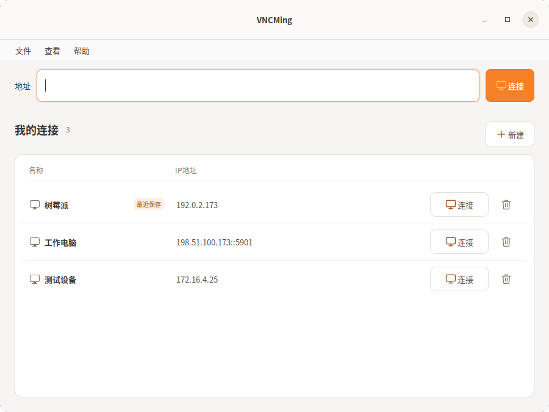
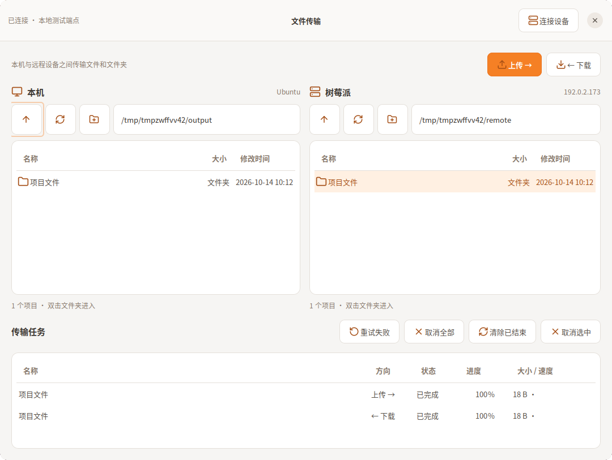

# VNCMing

简洁的 Ubuntu / Linux X11 远程桌面客户端。
支持保存连接、IP 搜索、画面缩放，以及文件与文件夹传输。密码保存在系统钥匙环。

## 界面预览

连接管理：输入 IP 连接，搜索已保存设备，双击列表编辑。



文件传输：左侧本机、右侧远程，下方查看上传与下载任务。



截图使用示例设备；文件传输截图来自本地模拟端点。

## 安装与启动

已在 Ubuntu 22.04 / GNOME 42 的 X11 桌面验证。

在仓库 Release 页面下载 `vncming_1.3.6_amd64.deb` 后安装：

```bash
sudo apt install ./vncming_1.3.6_amd64.deb
```

也可以从源码构建并安装：

```bash
git clone https://github.com/GCUSMS-AI-ProJect/vncming.git
cd vncming
./scripts/install-deps.sh
./install.sh
./vncming
```

远控界面按 **F8** 打开菜单、切换全屏。文件传输需远端开启 **SSH/SFTP**，默认端口 **22**。

主界面菜单栏的 **语言 / Language** 支持“跟随系统”“简体中文”和“English”。首次
启动跟随系统，其他系统语言使用英文。点击后当前界面和已打开的文件传输窗口立即切换，
选择会自动保存在本机，下次启动沿用上次选择。切换回“跟随系统”可恢复自动选择。
输入内容、列表选择和正在进行的传输保持不变。

[v1.3.6 更新说明](docs/releases/v1.3.6.md)

[文件传输说明](docs/FILE_TRANSFER.md) · [开发与打包](docs/DEVELOPMENT.md) · [GPL v2](LICENSE) · [图标来源](NOTICE.md)
