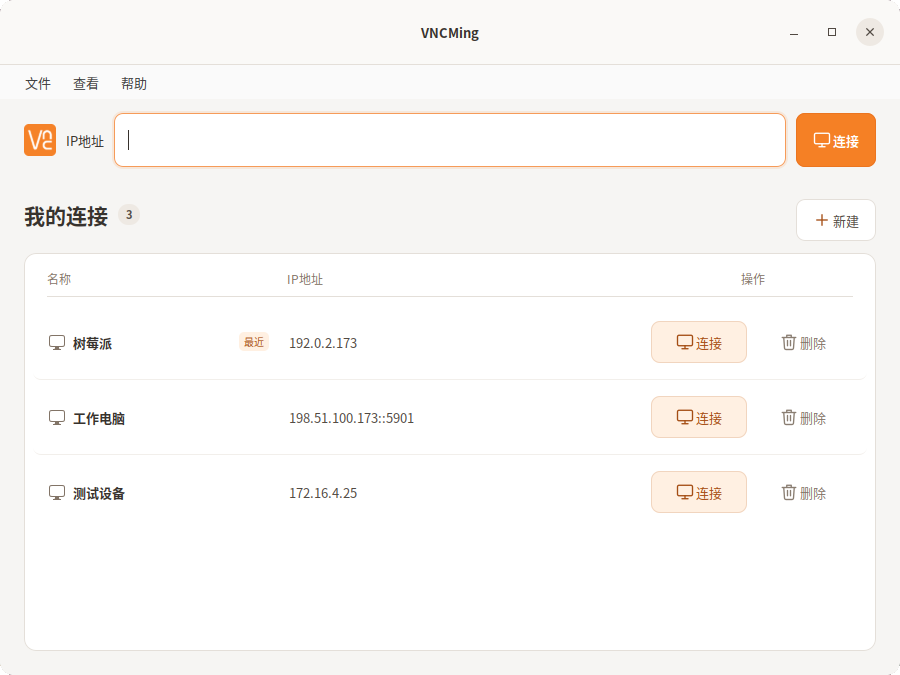
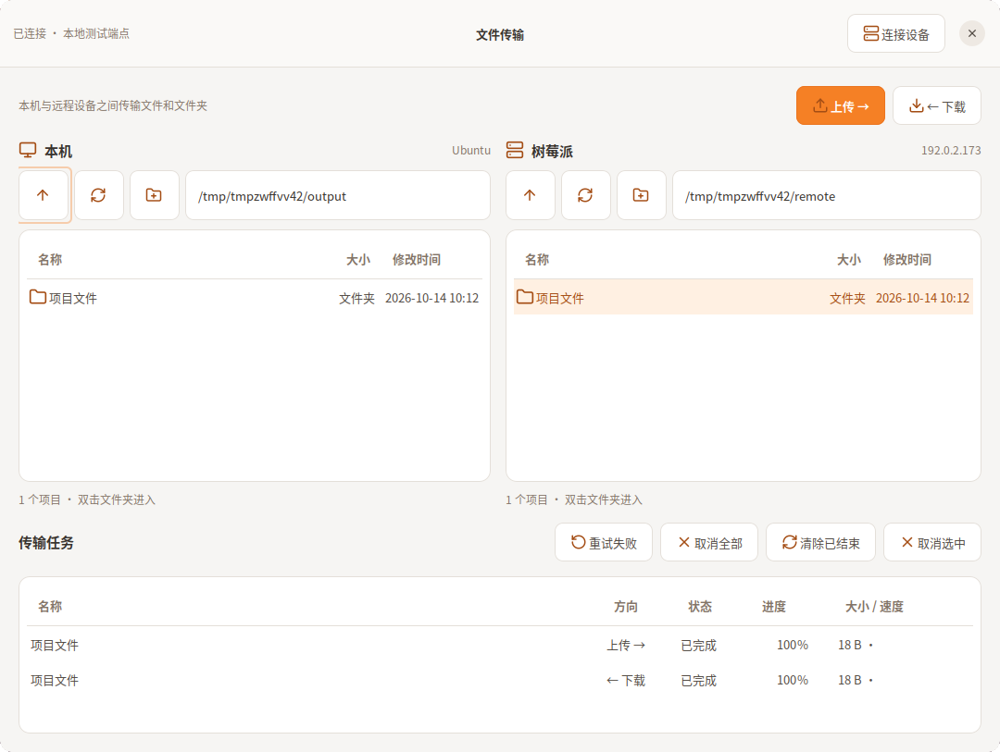

# VNCMing

简洁的 Ubuntu / Linux X11 远程桌面客户端，基于 TigerVNC。
支持保存连接、IP 搜索、画面缩放，以及文件与文件夹传输。密码保存在系统钥匙环。

## 界面预览

连接管理：输入 IP 连接，搜索已保存设备，双击列表编辑。



文件传输：左侧本机、右侧远程，下方查看上传与下载任务。



截图使用示例设备；文件传输截图来自本地模拟端点。

## 安装与启动

已在 Ubuntu 22.04 / GNOME 42 的 X11 桌面验证。

```bash
git clone https://github.com/GCUSMS-AI-ProJect/vncming.git
cd vncming
./scripts/install-deps.sh
./install.sh
./vncming
```

远控界面按 **F8** 打开菜单、切换全屏。文件传输需远端开启 **SSH/SFTP**，默认端口 **22**。

[文件传输说明](docs/FILE_TRANSFER.md) · [开发与打包](docs/DEVELOPMENT.md) · [GPL v2](LICENSE) · [图标来源](NOTICE.md)
